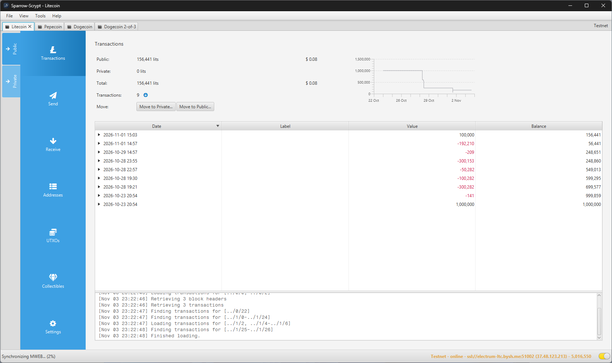
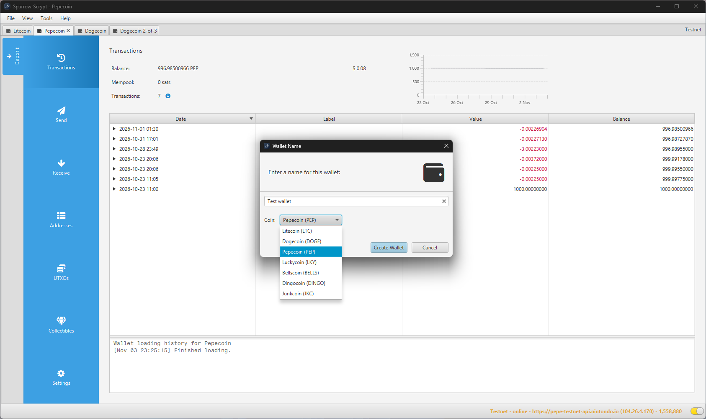
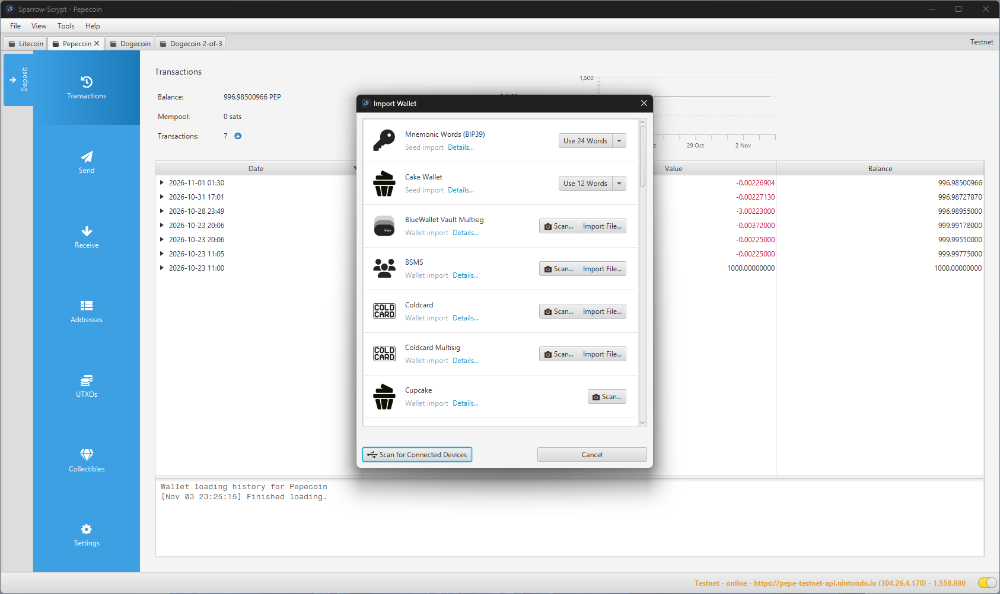
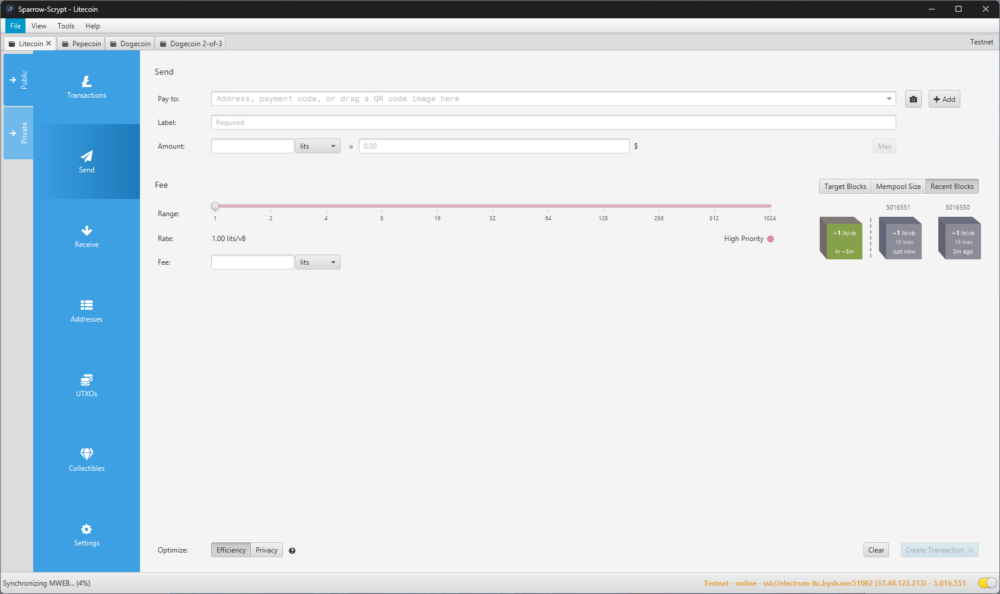
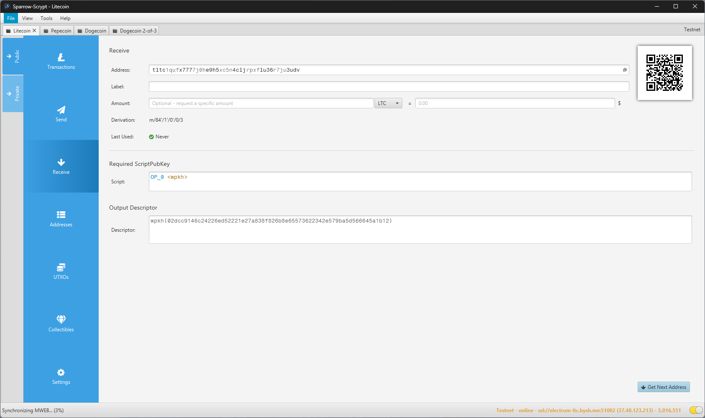
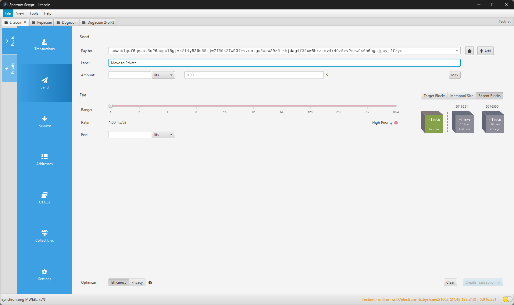
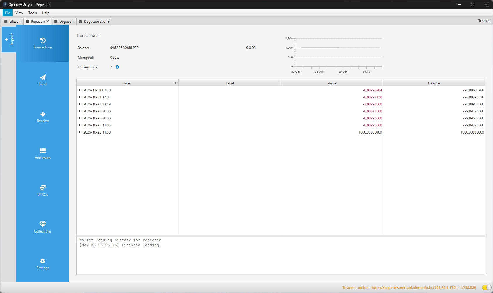

# Sparrow-Scrypt

Sparrow-Scrypt is a desktop wallet for the Scrypt coins: Litecoin, Dogecoin, Pepecoin, Junkcoin, Luckycoin, Bellscoin and Dingocoin, in one app. Each wallet belongs to one coin. It is built on [Sparrow-LTC](https://github.com/sparrow-ltc/sparrow), which is built on [Sparrow Wallet](https://github.com/sparrowwallet/sparrow), and keeps their focus on PSBTs, coin control and transparency.

The [wiki](../../wiki) has a guide to every part of the app.

## Status: beta

Current version: **2.5.7 beta 3** (tag `scrypt-v2.5.7-beta.3`), based on Sparrow Wallet 2.5.7.

Sparrow-Scrypt is in public testing. Expect bugs. Use test coins where you can and small amounts where you can't, and never put a seed that holds real savings into a beta build.

Every coin is supported on mainnet, through the public servers listed below or your own server.

| Coin | Ticker | Mainnet | Test mode |
| --- | --- | --- | --- |
| Litecoin | LTC | Supported (public Electrum servers) | Public testnet |
| Pepecoin | PEP | Supported (public Esplora server) | Public testnet |
| Junkcoin | JKC | Supported (public Esplora server) | Public testnet |
| Dogecoin | DOGE | Supported (public Electrum servers) | Your own node, or mainnet with small amounts |
| Luckycoin | LKY | Supported (public Esplora server) | Your own node, or mainnet with small amounts |
| Bellscoin | BELLS | Supported (public Esplora server) | Your own node, or mainnet with small amounts |
| Dingocoin | DINGO | Supported (public Electrum servers) | Your own node, or mainnet with small amounts |

## What it adds

- Seven Scrypt coins in one app, with servers set per coin and test mode for every coin.
- Litecoin MWEB: a private wallet next to the public one, one-click moves between them, and Electrum-LTC view-key import and export.
- Litecoin inscriptions and runes: view, protect, send, mint and etch. Inscriptions on Dogecoin, Pepecoin, Bellscoin and Junkcoin: view and send.
- Seed imports from each coin's own wallet app (MyDoge, Peppool, Dingo, JunkieWally, luckycoinwallet, Nintondo) and from Cake Wallet.
- An encrypted seed backup file (Argon2id and AES-GCM, with its own password).
- LitVM on testnet: zkLTC, ERC-20 tokens, token creation and bridges, linked to a Litecoin wallet.
- An Android companion app, [Sparrow-Scrypt Mobile](https://github.com/scryptofoundation/sparrow-scrypt-mobile), paired by QR, that can also act as an air-gapped signer.

## Screenshots

All taken in test mode with throwaway wallets.

| | |
| --- | --- |
|  |  |
| A new wallet: pick the coin | Import from a seed, Cake Wallet, or another wallet |
|  |  |
| Send | Receive |
|  |  |
| Move to Private fills in a send to the wallet's own MWEB address | A Pepecoin wallet on the public testnet |

## Roadmap

## Public servers

With Server set to Public Server, each coin connects to one of these. You can point any coin at your own Electrum server, Esplora API or node instead.

| Coin | Mainnet | Testnet |
| --- | --- | --- |
| Litecoin | Electrum: ltc.aftrek.org, electrum-ltc.bysh.me, electrum1.cipig.net, backup.electrum-ltc.org, l.fem.sh, fallacy.fiatfaucet.com, electrum.jhoenicke.de, electrum.jochen-hoenicke.de, electrum.petrkr.net, ltc.rentonisk.com, electrum.ltc.xurious.com | Electrum: electrum-ltc.bysh.me, electrum.ltc.xurious.com |
| Dogecoin | Electrum: doge.electrum1.cipig.net, doge.electrum2.cipig.net, dogecoin.stackwallet.com, doge.aftrek.org | None |
| Dingocoin | Electrum: seed1.dingocoin.com, seed3.dingocoin.com, elecx2.kmsoftware.org | None |
| Pepecoin | Esplora: peppool.space | Esplora: pepe-testnet-api.nintondo.io |
| Junkcoin | Esplora: junk-api.s3na.xyz, explorer.junk-coin.com (read only, cannot broadcast) | Esplora: jkc-testnet-api.s3na.xyz |
| Luckycoin | Esplora: luckyscan.org | None |
| Bellscoin | Esplora: api.nintondo.io | None |

Inscriptions are read from ordinalslite.com for Litecoin and from Nintondo for Dogecoin, Pepecoin and Bellscoin, or from your own ord server. Junkcoin inscriptions need your own ord-junkcoin server.

## Downloads

Builds are on the [Releases](../../releases) page, with SHA256 checksums. Check the file before you run it.

| System | Installer | Portable |
| --- | --- | --- |
| Windows 10 and 11, x64 | `Sparrow-Scrypt-2.5.7.msi` | `Sparrow-Scrypt-2.5.7.zip` |
| Linux x64 (Debian, Ubuntu) | `sparrowscryptwallet_2.5.7-1_amd64.deb` | `sparrowscryptwallet-2.5.7-x86_64.tar.gz` |
| macOS 11 or later, Apple Silicon | | `Sparrow-Scrypt-2.5.7-macos-aarch64.zip` |
| macOS 11 or later, Intel | | `Sparrow-Scrypt-2.5.7-macos-x86_64.zip` |

- macOS: unzip, move `Sparrow-Scrypt.app` to Applications and open it. The app is signed and notarized by Apple.
- Windows: run the `.msi`, or unzip the portable build and run `Sparrow-Scrypt.exe`. The Windows builds are not code-signed yet, so if SmartScreen stops it, choose More info, then Run anyway.
- Linux: install the `.deb` (`sudo apt install ./sparrowscryptwallet_2.5.7-1_amd64.deb`), or extract the portable build and run `Sparrow-Scrypt/bin/sparrow`.

## Building

Clone with the drongo and lark submodules:

`git clone --recursive https://github.com/scryptofoundation/sparrow-scrypt.git`

Building needs Java 25 or higher; the release builds use [Eclipse Temurin](https://adoptium.net/) 25. Build the app with

`./gradlew jpackageImage`

and find it in `build/jpackage/Sparrow-Scrypt`. To run from source instead, use `./sparrow` in the project folder.

`-Pcoin=ltc|doge|pep|lky|bells|dingo` builds a single-coin app (for example Sparrow-DOGE) instead of the multi-coin one.

## Configuration

`./sparrow -h` lists the command line options. The most useful are `--dir` for another home folder and `--network` for `testnet` or `regtest`.

The config file, log and wallets live in:

| Platform | Location |
| --- | --- |
| Windows | `%APPDATA%\Sparrow-Scrypt` |
| macOS and Linux | `~/.sparrow-scrypt` |

Test networks keep their own config and wallets in subfolders.

## Reporting problems

Open an issue in this repository with the coin, the build, your system and what happened. The `sparrow.log` file in the home folder usually helps. Never post a seed, a private key or a wallet file.

## License

Sparrow-Scrypt is licensed under the Apache 2 software licence, like Sparrow Wallet and Sparrow-LTC.

## Credit

Sparrow Wallet is by Craig Raw. Sparrow-LTC, the Litecoin port this builds on, is by Hector Chu.
